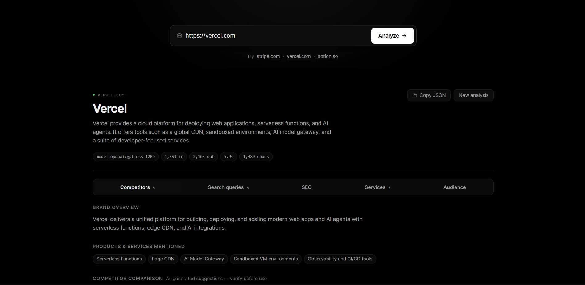

# AI-Powered Website Link Analysis API (Groq)

FastAPI prototype that takes a public website URL, extracts its content, sends it to **Groq**
(`openai/gpt-oss-120b`, with `openai/gpt-oss-20b` as fallback) and returns five structured
analysis sections:

1. Competitor vs. your brand
2. Top 5 target search queries (Google, Facebook, Instagram, LinkedIn, X)
3. SEO improvements (keywords, title, meta description, supporting content)
4. Top 5 services
5. Target audience identification

> Prototype scope: one endpoint (`POST /link-analysis`), no database, no auth, no caching.
> Groq is the only LLM provider used at runtime.

<!-- Hero: browser UI screenshot -->
## Demo



## Quick start

```bash
git clone https://github.com/HimanshuTamoli24/practical-test.git
cd practical-test

python -m venv .venv
.venv\Scripts\activate           # Windows (macOS/Linux: source .venv/bin/activate)
pip install -r requirements.txt

copy .env.example .env           # macOS/Linux: cp .env.example .env
# then edit .env and set GROQ_API_KEY=gsk_...
```

Get a free key at <https://console.groq.com/keys>. `.env`:

```ini
GROQ_API_KEY=gsk_...
GROQ_MODEL=openai/gpt-oss-120b
GROQ_FALLBACK_MODEL=openai/gpt-oss-20b
```

Run it and open <http://localhost:4000>:

```bash
uvicorn app.main:app --port 4000
```

## Stack

| Layer | Tech |
|---|---|
| API | FastAPI + Uvicorn (Pydantic v2) |
| LLM | Groq `openai/gpt-oss-120b`, fallback `openai/gpt-oss-20b`, JSON mode |
| Scraping | httpx + BeautifulSoup, SSRF-safe URL validation |
| UI | `app/static/index.html`, one file, no build step |
| Tests | pytest (`Groq` mocked), 18 tests |

## Endpoint

```bash
curl -X POST http://localhost:4000/link-analysis \
  -H "Content-Type: application/json" \
  -d '{"url": "https://vercel.com"}'
```

`POST /link-analysis` takes `{ "url": "..." }` and returns competitors, search queries, SEO,
services and audience. Swagger UI: <http://localhost:4000/docs>.

---

## 1. Project structure

```text
practical-test/
├── app/
│   ├── main.py                        # FastAPI app + POST /link-analysis
│   ├── config.py                      # env-based settings
│   ├── schemas.py                     # Pydantic request/response models
│   ├── static/
│   │   └── index.html                 # browser UI (no build step)
│   ├── services/
│   │   ├── website_extractor.py       # HTTP fetch + BeautifulSoup extraction
│   │   ├── llm_service.py             # Groq chat-completions client (JSON mode)
│   │   └── analysis_service.py        # prompt, normalization into schema
│   └── utils/
│       └── validators.py              # URL validation + SSRF protection
├── tests/test_link_analysis.py        # 18 tests, Groq mocked
├── .env.example
├── requirements.txt
└── README.md
```

## 2. How it works

```text
POST /link-analysis
  → validate URL (scheme, host syntax, public-IP check, redirect re-validation)
  → fetch HTML with httpx (5 redirects max, 2 MB cap, 30 s timeout)
  → BeautifulSoup: drop scripts/styles/nav noise, keep title, meta, headings, text, links
  → truncate to MAX_CONTENT_CHARS (12 000 chars) and build the prompt
  → Groq /chat/completions with response_format = json_object
  → normalize LLM JSON into the Pydantic response model
  → 400 / 422 / 502 / 503 on the appropriate failure
```

## 3. Setup

```bash
python -m venv .venv
# Windows
.venv\Scripts\activate
# macOS / Linux
source .venv/bin/activate

pip install -r requirements.txt
copy .env.example .env        # cp .env.example .env
# put your key in .env:  GROQ_API_KEY=gsk_...
```

Get a key at <https://console.groq.com/keys>.

> **Windows note:** the file must be named exactly `.env` in the project root (not `.env.txt`).
> Explorer creates it without a name only via `New → Text Document` + rename; verify with
> `Get-ChildItem -Force` — it should appear in the listing. `.env` is git-ignored.

Run:

```bash
uvicorn app.main:app --host 0.0.0.0 --port 4000
```

- **Browser UI:** <http://localhost:4000>
- Swagger UI: <http://localhost:4000/docs>
- Health: <http://localhost:4000/health>

> Opening `app/static/index.html` with a static server such as VS Code Live Server
> (`http://127.0.0.1:5500`) also works: the page detects the foreign port and sends its
> API calls to `http://localhost:4000`. Start FastAPI first, or every request will fail.

## 4. Browser UI

`app/static/index.html` is a single self-contained page (no build step, no CDN) served at `/`.
It follows a clean, Vercel-style system: near-black on white, tight display type, hairline
borders, a segmented tab bar and subtle shadows, with automatic dark mode via
`prefers-color-scheme`.

Flow: enter a URL (or click an example) → inline loading state → the five analysis sections
render in tabs (Competitors, Search queries, SEO, Services, Audience) → **Copy JSON** exports the
raw response. The page calls `/health` on load and shows a warning banner when `GROQ_API_KEY`
is missing.

## 5. API

### Request

```http
POST http://localhost:4000/link-analysis
Content-Type: application/json
```

```json
{
  "url": "https://example.com"
}
```

`https://` is added automatically when the scheme is missing, so `example.com` works too.

### Sample response (trimmed)

```json
{
  "success": true,
  "website": "https://example.com",
  "brand": {
    "name": "Acme Consulting",
    "category": "Business Consulting",
    "summary": "Acme helps B2B SaaS teams grow revenue."
  },
  "analysis": {
    "competitor_analysis": {
      "brand_overview": "Acme helps B2B SaaS teams grow revenue.",
      "main_category": "Business Consulting",
      "products_and_services": ["Growth strategy", "Sales enablement"],
      "competitors": [
        {
          "name": "Example Competitor",
          "main_service": "Enterprise consulting",
          "target_market": "Enterprises",
          "key_strength": "Brand recognition",
          "weakness_or_gap": "Slow delivery for small teams",
          "opportunity": "Win on speed and pricing",
          "basis": "AI-generated suggestion (not externally verified)"
        }
      ],
      "competitive_advantages": ["Specialist SaaS focus"],
      "strengths": ["Clear niche positioning"],
      "opportunities": ["Publish case studies"]
    },
    "target_search_queries": [
      {
        "query": "saas growth consulting",
        "platforms": ["Google", "LinkedIn"],
        "intent": "Service search",
        "business_relevance": "High-intent buyers looking for specialist help",
        "target_audience": "SaaS founders"
      }
    ],
    "seo_improvements": {
      "primary_keyword": "SaaS growth consulting",
      "secondary_keywords": ["revenue consulting", "B2B growth strategy"],
      "long_tail_keywords": ["saas revenue growth consultant for startups"],
      "business_keywords": ["b2b consulting"],
      "recommended_title": "SaaS Growth Consulting for B2B Teams",
      "meta_description": "Acme helps B2B SaaS teams build predictable revenue with hands-on growth consulting.",
      "supporting_content": ["Customer case studies", "SaaS pricing guide"]
    },
    "top_services": [
      {
        "name": "Growth strategy",
        "description": "Revenue and pipeline planning",
        "target_industry": "B2B SaaS",
        "target_customer": "Founder-led teams",
        "main_benefit": "Predictable pipeline",
        "source": "website content"
      }
    ],
    "target_audience": {
      "primary_audience": ["SaaS founders"],
      "secondary_audience": ["Sales leaders"],
      "industries": ["B2B SaaS"],
      "business_types": ["Startups", "SMBs"],
      "customer_profiles": ["Founder-led sales teams"],
      "location_focus": null,
      "customer_needs": ["Predictable pipeline"],
      "customer_interests": ["Growth tactics"],
      "recommended_segments": ["Seed to Series A SaaS"]
    }
  },
  "meta": {
    "provider": "Groq",
    "model": "openai/gpt-oss-120b",
    "input_tokens": 3720,
    "output_tokens": 1180,
    "response_ms": 3100,
    "extracted_characters": 11840
  },
  "disclaimer": "Insights are generated by an LLM from the public page content. Competitor details are AI-generated suggestions and may require verification. No search-volume or ranking data is claimed."
}
```

### Error handling

| Status | When |
|---|---|
| `400` | Malformed URL, unsupported scheme, credentials in URL, host resolves to a private/loopback/reserved IP (SSRF protection), redirect to an internal host |
| `422` | Body missing `url` or `url` too long |
| `502` | Site unreachable / HTTP 4xx-5xx / non-HTML / too large, or Groq request failed after retries |
| `503` | `GROQ_API_KEY` not configured |

Each platform/host is fetched in isolation; a failure returns a clear error instead of a
500 stack trace. Redirects are followed manually (max 5) and **re-validated** on every hop.

## 6. LLM platform & model research (Groq-only runtime)

The task asks for a comparison. Runtime calls **only Groq**; the table below compares three
models that Groq itself hosts, so switching models is an env change (`GROQ_MODEL`) and nothing else.
Prices are Groq's published per-1M-token prices, checked on **18 Nov 2026** at
<https://console.groq.com/docs/models> — verify before quoting them elsewhere.

| Provider | Model ID | Price (input / output per 1M tokens) | Speed (published) | Context | JSON support | Recommendation |
|---|---|---|---|---|---|---|
| Groq | `openai/gpt-oss-120b` | $0.15 / $0.60 | ~500 tok/s | 131,072 | Yes (`json_object`) | **Primary** — best reasoning per dollar for multi-section analysis |
| Groq | `openai/gpt-oss-20b` | $0.075 / $0.30 | ~1,000 tok/s | 131,072 | Yes | **Fallback** — 2× cheaper/faster, slightly weaker competitor reasoning |
| Groq | `qwen/qwen3.8-27b` (preview) | $0.80 / $4.00 | ~450 tok/s | 131,072 | Yes | Not selected — ~5-6× higher cost, preview-only |
| Groq | `llama-3.3-70b-versatile` | Enterprise (contact sales) | ~280 tok/s | 131,072 | Yes | Not selected — no public self-serve price on the current model page |

**Why Groq + `gpt-oss-120b`:** very low latency (hundreds of tokens/sec), native JSON mode,
131k context (this app only sends ~12k characters, so cost stays tiny), and no per-request
minimum. Accuracy figures are **not measured here** — no live benchmark was run in this
prototype; the recommendation is based on published specs and the model's reasoning class.

### Cost estimate per analysis

| Item | Estimate |
|---|---|
| Extracted page content | ≤ 12,000 chars ≈ 3,000 tokens |
| System + page metadata prompt | ≈ 700 tokens |
| Output JSON | ≈ 1,200 tokens |
| **gpt-oss-120b cost** | `3,700 × $0.15/1M + 1,200 × $0.60/1M` ≈ **$0.0013** |
| **gpt-oss-20b cost** | ≈ **$0.0006** |
| Expected latency | ~2–6 s on Groq (estimate, not measured here) |

### Cost optimisation already applied

- HTML is stripped of scripts/styles/forms and duplicate lines before prompting.
- Content is capped at `MAX_CONTENT_CHARS` (default 12,000) with a hard page-size limit.
- One LLM call per request; no retry loop on successful responses.
- Competitor, SEO and audience sections are produced in a **single** JSON response.
- `reasoning_effort: "low"` for GPT-OSS models to cut reasoning tokens.
- Fallback model is used only when the primary is unavailable — not on every request.
- Possible next step: cache normalized page text and results by URL (Redis / TTL) to avoid
  re-billing unchanged pages.

## 7. Configuration

| Variable | Default | Purpose |
|---|---|---|
| `GROQ_API_KEY` | — | Required |
| `GROQ_MODEL` | `openai/gpt-oss-120b` | Primary model |
| `GROQ_FALLBACK_MODEL` | `openai/gpt-oss-20b` | Used if primary is unavailable |
| `GROQ_BASE_URL` | `https://api.groq.com/openai/v1` | OpenAI-compatible Groq base URL |
| `REQUEST_TIMEOUT` | `30` | Website fetch timeout (seconds) |
| `LLM_TIMEOUT` | `60` | Groq request timeout (seconds) |
| `MAX_PAGE_BYTES` | `2000000` | Max downloaded HTML size |
| `MAX_CONTENT_CHARS` | `12000` | Max characters sent to the LLM |

`.env` is git-ignored; only `.env.example` is committed.

## 8. Tests

```bash
pytest -q
```

18 tests cover URL normalization, SSRF blocking, HTML extraction/cleaning, lenient LLM-output
normalization, UI serving, and the endpoint's 422/400/502/503/success paths. Groq and network
calls are mocked, so no key is needed.

## 9. Known limitations

- Single-page analysis only (no crawling of subpages).
- JS-rendered sites may return little text; no headless browser is bundled.
- Competitors are AI suggestions, not verified against external data, and are labelled as such.
- No search-volume data is returned (per the task's instruction not to invent volumes).
- No caching, rate limiting or API auth — fine for a prototype, required before production.
